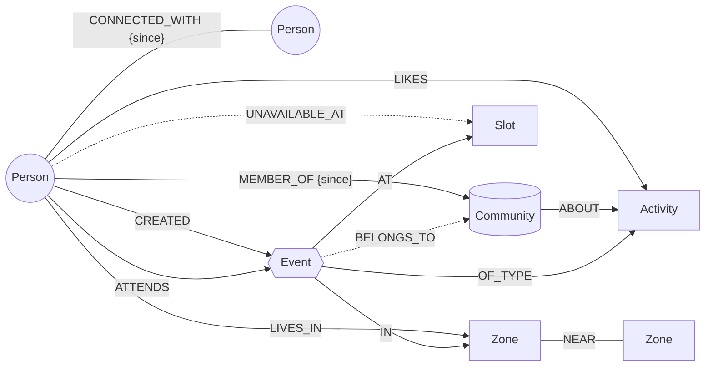

# Model de dades d'AFINIT

AFINIT guarda les dades en un graf (Neo4j). Les persones, activitats, zones, franges horàries,
quedades i comunitats són **nodes**, i tot el que els relaciona (què li agrada a qui, on viu, quan
no pot, amb qui està connectat...) són **relacions**. Les recomanacions de persones afins i de
quedades surten de recórrer aquestes relacions, no de creuar taules.

## Nodes

| Etiqueta    | Propietats                                                          | Clau única        | Notes |
|-------------|---------------------------------------------------------------------|-------------------|-------|
| `Person`    | `id`, `name`, `age`, `email`, `passwordHash`, `createdAt`           | `id`, `email`     | Usuari de l'app. `createdAt` és `datetime`. |
| `Activity`  | `name`                                                              | `name`            | Catàleg fix: Córrer, Escalada, Jocs de taula, Ciclisme, Pàdel, Senderisme, Ioga, Fotografia, Natació, Futbol. |
| `Zone`      | `name`                                                              | `name`            | Catàleg fix: Girona i 9 municipis del voltant. |
| `Slot`      | `id`, `day`, `hour`                                                 | `id`              | Franja d'una hora. `day` ∈ Dl, Dm, Dc, Dj, Dv, Ds, Dg; `hour` = hora d'inici (8..21); `id` = `"Dl-19"`. 98 nodes fixos. |
| `Event`     | `id`, `title`, `description`, `date`, `hour`, `place`, `capacity`, `createdAt` | `id`   | Quedada. `date` és `date`, `place` és el punt de trobada en text lliure. |
| `Community` | `id`, `name`, `description`                                         | `id`              | Grup estable de persones al voltant d'una activitat. |

Les claus úniques es defineixen a [`data/00_constraints.cypher`](../data/00_constraints.cypher).
Cada restricció d'unicitat crea també un índex, i això fa que els `MATCH`/`MERGE` per clau siguin ràpids.

## Relacions

| Relació | Propietats | Significat |
|---------|------------|------------|
| `(Person)-[:LIKES]->(Activity)` | — | A la persona li interessa l'activitat. |
| `(Person)-[:LIVES_IN]->(Zone)` | — | Zona on viu la persona (una per persona). |
| `(Zone)-[:NEAR]->(Zone)` | — | Les dues zones són veïnes (municipis que limiten). Es crea en un sol sentit i es consulta **sense direcció**: `(a)-[:NEAR]-(b)`. |
| `(Person)-[:UNAVAILABLE_AT]->(Slot)` | — | La persona **no** està disponible en aquesta franja. Sense relació = disponible. |
| `(Person)-[:CONNECTED_WITH {since}]->(Person)` | `since` | Dues persones s'han connectat a l'app. Simètrica: es consulta sense direcció. |
| `(Person)-[:MEMBER_OF {since}]->(Community)` | `since` | La persona forma part de la comunitat. |
| `(Community)-[:ABOUT]->(Activity)` | — | Activitat principal de la comunitat. |
| `(Person)-[:CREATED]->(Event)` | — | La persona ha organitzat la quedada. |
| `(Person)-[:ATTENDS]->(Event)` | — | La persona hi està apuntada (inclou l'organitzador). |
| `(Event)-[:OF_TYPE]->(Activity)` | — | Activitat que es fa a la quedada. |
| `(Event)-[:IN]->(Zone)` | — | Zona on es fa la quedada. |
| `(Event)-[:AT]->(Slot)` | — | Franja setmanal de la quedada (dia de la setmana + hora), coherent amb `date` i `hour`. |
| `(Event)-[:BELONGS_TO]->(Community)` | — | Opcional: la quedada s'organitza dins d'una comunitat. |

## Diagrama



Les fletxes sense punta (`NEAR`, `CONNECTED_WITH`) indiquen relacions que es guarden en un sentit
però que tenen significat simètric. `BELONGS_TO` és opcional.

## Dades fixes

Hi ha dades que no canvien amb l'ús de l'app i que es carreguen una sola vegada amb
[`data/01_dades_fixes.cypher`](../data/01_dades_fixes.cypher):

- 10 activitats.
- 10 zones i les relacions `NEAR` entre zones veïnes (16).
- Les 98 franges `Slot` (7 dies × hores de 8 a 21), generades amb `UNWIND`.

Tots els scripts són idempotents (`MERGE`, `IF NOT EXISTS`): tornar-los a executar no crea duplicats.

## Per què guardem la NO disponibilitat

Per saber quan es poden trobar dues persones hi ha dues opcions: guardar les franges en què
cada persona **pot** (`AVAILABLE_AT`) o les franges en què **no pot** (`UNAVAILABLE_AT`).
Hem triat la segona:

1. **Un usuari nou és útil des del primer moment.** Sense cap relació, la persona es considera
   disponible a totes hores i ja apareix a les recomanacions. Amb `AVAILABLE_AT`, un usuari que
   no ha omplert l'horari no coincidiria amb ningú i quedaria invisible.
2. **Es guarden moltes menys relacions.** La majoria de gent pot quedar la major part de les
   98 franges i només té unes quantes excepcions (feina, classes...). La Paula, per exemple, té
   11 relacions `UNAVAILABLE_AT`; amb el model contrari en necessitaria 87.
3. **És com la gent pensa el seu horari.** És més natural dir "els matins entre setmana no puc"
   que marcar una per una totes les hores en què sí que pot. A la pantalla de l'horari,
   l'usuari marca les excepcions.
4. **El graf queda més net.** Els nodes `Slot` no s'omplen de milers de relacions que no aporten
   informació, i les que hi ha són justament les que restringeixen.

El preu és que les consultes de disponibilitat es fan per negació: una franja és comuna a dues
persones si **cap** de les dues hi té `UNAVAILABLE_AT`.

```cypher
MATCH (s:Slot)
WHERE NOT EXISTS { (p)-[:UNAVAILABLE_AT]->(s) }
  AND NOT EXISTS { (o)-[:UNAVAILABLE_AT]->(s) }
RETURN count(s) AS frangesComunes
```

Com que només hi ha 98 franges i cada persona en té poques marcades, aquesta comprovació és
barata. La consulta completa de persones afins és a
[`data/consultes_comprovacio.cypher`](../data/consultes_comprovacio.cypher).
