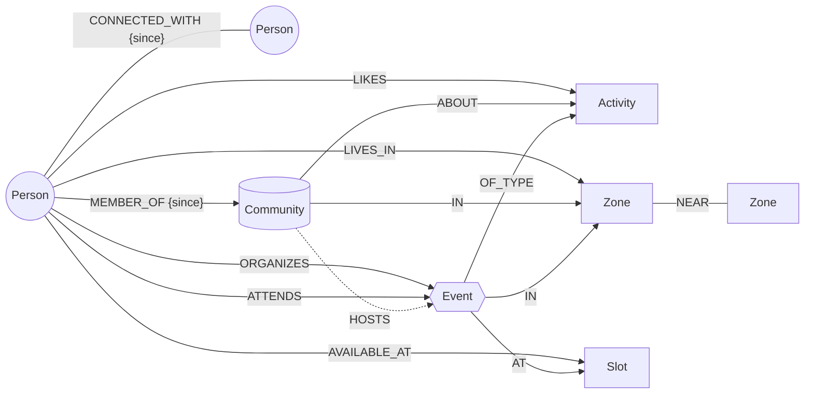

# Model de dades d'AFINIT

AFINIT guarda les dades en un graf (Neo4j). Les persones, activitats, zones, franges horàries,
quedades i comunitats són **nodes**, i tot el que els relaciona (què li agrada a qui, on viu, quan
pot quedar, amb qui està connectat...) són **relacions**. Les recomanacions de persones afins i de
quedades surten de recórrer aquestes relacions, no de creuar taules.

## Nodes

| Etiqueta    | Propietats                                                          | Clau única        | Notes |
|-------------|---------------------------------------------------------------------|-------------------|-------|
| `Person`    | `id`, `name`, `age`, `email`, `passwordHash`, `createdAt`           | `id`, `email`     | Usuari de l'app. `id` és un UUID generat pel backend. |
| `Activity`  | `name`                                                              | `name`            | Catàleg fix: Córrer, Escalada, Jocs de taula, Ciclisme, Pàdel, Senderisme, Ioga, Fotografia, Natació, Futbol. |
| `Zone`      | `name`                                                              | `name`            | Catàleg fix: Girona i 9 municipis del voltant. |
| `Slot`      | `id`, `day`, `hour`                                                 | `id`              | Franja d'una hora. `day` ∈ Dl, Dm, Dc, Dj, Dv, Ds, Dg; `hour` = hora d'inici (8..21); `id` = `"Dl-19"`. 98 nodes fixos. |
| `Event`     | `id`, `title`, `description`, `date`, `startTime`, `endTime`, `place`, `capacity`, `createdAt` | `id` | Quedada. `date` és `date`; `startTime`/`endTime` són text `"HH:MM"`; `place` és el punt de trobada. |
| `Community` | `id`, `name`, `description`                                         | `id`              | Grup estable de persones al voltant d'una activitat. |

Les claus úniques es defineixen a [`data/00_constraints.cypher`](../data/00_constraints.cypher).
Cada restricció d'unicitat crea també un índex, i això fa que els `MATCH`/`MERGE` per clau siguin ràpids.

## Relacions

| Relació | Propietats | Significat |
|---------|------------|------------|
| `(Person)-[:LIKES]->(Activity)` | — | A la persona li interessa l'activitat. |
| `(Person)-[:LIVES_IN]->(Zone)` | — | Zona on viu la persona (una per persona). |
| `(Zone)-[:NEAR]->(Zone)` | — | Les dues zones són veïnes (municipis que limiten). Es crea en un sol sentit i es consulta **sense direcció**: `(a)-[:NEAR]-(b)`. |
| `(Person)-[:AVAILABLE_AT]->(Slot)` | — | La persona **pot** quedar en aquesta franja. |
| `(Person)-[:CONNECTED_WITH {since}]->(Person)` | `since` | Dues persones s'han connectat a l'app. Simètrica: es consulta sense direcció. |
| `(Person)-[:MEMBER_OF {since}]->(Community)` | `since` | La persona forma part de la comunitat. |
| `(Community)-[:ABOUT]->(Activity)` | — | Activitat principal de la comunitat. |
| `(Community)-[:IN]->(Zone)` | — | Zona on es mou la comunitat. |
| `(Person)-[:ORGANIZES]->(Event)` | — | La persona ha organitzat la quedada. |
| `(Person)-[:ATTENDS]->(Event)` | — | La persona hi està apuntada (inclou l'organitzador). |
| `(Event)-[:OF_TYPE]->(Activity)` | — | Activitat que es fa a la quedada. |
| `(Event)-[:IN]->(Zone)` | — | Zona on es fa la quedada. |
| `(Event)-[:AT]->(Slot)` | — | Franges setmanals que ocupa la quedada: una relació per cada hora que dura. |
| `(Community)-[:HOSTS]->(Event)` | — | Opcional: la quedada s'organitza dins d'una comunitat. |

## Diagrama



Les fletxes sense punta (`NEAR`, `CONNECTED_WITH`) indiquen relacions que es guarden en un sentit
però que tenen significat simètric. `HOSTS` és opcional.

## Dades fixes (catàleg)

Hi ha dades que no canvien amb l'ús de l'app i que es carreguen una sola vegada amb
[`data/01_dades_fixes.cypher`](../data/01_dades_fixes.cypher):

- 10 activitats.
- 10 zones i les relacions `NEAR` entre zones veïnes (16).
- Les 98 franges `Slot` (7 dies × hores de 8 a 21), generades amb `UNWIND`.

L'API les ha de buscar amb `MATCH` i no crear-les mai amb `MERGE`: si no, qualsevol valor que arribi
(una errada, o el `"string"` de la pàgina de proves de l'API) acaba convertit en una zona o activitat nova.

Tots els scripts són idempotents (`MERGE`, `IF NOT EXISTS`): tornar-los a executar no crea duplicats.

## Disponibilitat: per què guardem `AVAILABLE_AT`

Per saber quan es poden trobar dues persones hi havia dues opcions: guardar les franges en què
cada persona **pot** (`AVAILABLE_AT`) o les franges en què **no pot** (`UNAVAILABLE_AT`).
Hem triat la primera:

1. **La coincidència és un camí del graf.** Dues persones poden quedar en una franja si hi ha el camí
   `(p)-[:AVAILABLE_AT]->(s:Slot)<-[:AVAILABLE_AT]-(o)`. La consulta és un patró directe, sense negacions,
   i al Neo4j Browser es veu literalment el node franja que comparteixen. Amb `UNAVAILABLE_AT`, la
   coincidència seria l'absència de relacions (`NOT EXISTS`), que no es pot dibuixar.
2. **Encaixa amb la filosofia del projecte:** les relacions són la informació.
3. **El volum no és un problema.** Com a molt hi ha 98 relacions per persona, i amb els usuaris de la demo
   són pocs milers de relacions, que Neo4j recorre sense cost.

**Interfície:** a la pantalla d'horari l'usuari marca les hores en què **no** pot, que és més natural
("els matins entre setmana no puc"). El backend calcula el complement i guarda les `AVAILABLE_AT`.

**Inconvenient assumit:** una persona sense cap `AVAILABLE_AT` no surt a les recomanacions. Per això la
disponibilitat es demana en crear el perfil.

```cypher
MATCH (p:Person {email: $email})-[:AVAILABLE_AT]->(s:Slot)<-[:AVAILABLE_AT]-(o:Person)
RETURN o.name AS persona, count(s) AS frangesComunes
ORDER BY frangesComunes DESC
```

La consulta completa de persones afins és a
[`data/consultes_comprovacio.cypher`](../data/consultes_comprovacio.cypher).
